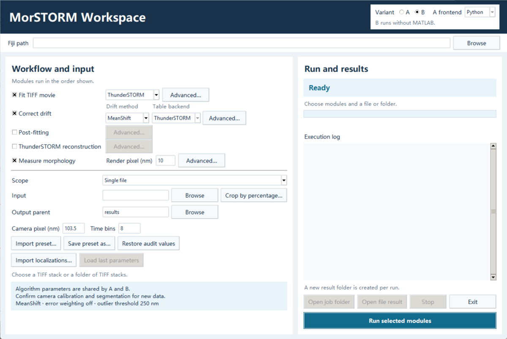

# MorSTORM

[简体中文](README.zh.md) · [Installation](docs/INSTALL.md) · [Validation](docs/VALIDATION.md) · [Release review](docs/RELEASE.md)

MorSTORM processes single-molecule localization microscopy data through TIFF localization with ThunderSTORM or Picasso, drift correction, post-fitting, reconstruction, and XY morphology with Fiji/MorphoLibJ. The bilingual desktop workspace supports individual modules, ordered combinations, single files and folders.

Each stage has an **Advanced…** button for the selected algorithm. The panels show units, current values, audit defaults, and fixed settings. Import, save, and restore controls let both variants use the same parameter preset. [Desktop setup and presets](docs/INSTALL.md#start-the-desktop-workspace)

Use **Crop by percentage…** for raw TIFF inputs, or **Import localizations…** to reconstruct a CSV or HDF5 localization table with ThunderSTORM. The **Post-fitting** stage provides native ThunderSTORM quality and density filtering, duplicate removal, and merging. It also supports Picasso quality filters and native Link. The workspace saves the Fiji path and can save the last run’s parameter preset after completion. [Desktop controls](docs/INSTALL.md#start-the-desktop-workspace)



| Capability | Variant A | Variant B |
| --- | --- | --- |
| Entry point | MATLAB or Python | Python without MATLAB |
| MeanShift | Pinned author code, installed separately | Included native Python port |
| NP-Cloud and RR-NP Cloud | Pinned author code, installed separately | Optional checksum-verified local port |
| AIM | Pinned author code, installed separately | Optional checksum-verified local port |
| Morphology | Fiji/MorphoLibJ, installed separately | Same Fiji/MorphoLibJ backend |

The public candidate ships the MeanShift port and supports local installation of additional B providers. A new clone can run the synthetic MeanShift example without MATLAB, Java or microscope data. [Provider installation and scope](docs/LOCAL_PROVIDERS.md)

## Quick start on Windows

Run in PowerShell from the repository root using Python 3.10.

```powershell
py -3.10 -m venv .venv
.\.venv\Scripts\python.exe -m pip install -c constraints-py310.txt ./MorSTORM-B ./MorSTORM-dual
.\.venv\Scripts\morstorm-b.exe MorSTORM-B/examples/drift-only.json
```

The example reads 960 synthetic localizations and writes the corrected table and drift to `results/b-demo/`. Use `--output` with a fresh directory to repeat it. Linux CLI users can use `python3.10 -m venv .venv` and `.venv/bin/` in place of `.venv/Scripts/`.

Install Fiji/MorphoLibJ for morphology, add ThunderSTORM to Fiji for its raw localization path, or install the optional Picasso dependency for Picasso raw localization. Save the local Fiji path, then double-click `Start-English.cmd` or `Start-Chinese.cmd`.

```powershell
.\.venv\Scripts\python.exe scripts/configure.py --fiji 'C:/path/to/Fiji.app'
```

Choose the modules, then select a file or folder. Include localization to start from TIFF. To start from a CSV or HDF5 table, select drift, morphology or both. Each file produces its own results, configuration and manifest. The folder report records failed files and the remaining files continue. For A and for a fresh workstation, follow [Installation](docs/INSTALL.md).

The presets are starting points from an audited acquisition. Use the actual camera scale, detection settings and frame segmentation for new data. Morphology measures the XY projection. The validation scope and weighted MeanShift finding are documented separately. [Validation](docs/VALIDATION.md)

This repository is a release candidate for the MorSTORM extension. The [original MorSTORM repository](https://github.com/YPZ858/MorSTORM) contains its own legacy code, manual and example data. Attribution and redistribution scope are listed in [THIRD_PARTY.md](THIRD_PARTY.md). Cite the project and the algorithms you use. [CITATION.cff](CITATION.cff)
