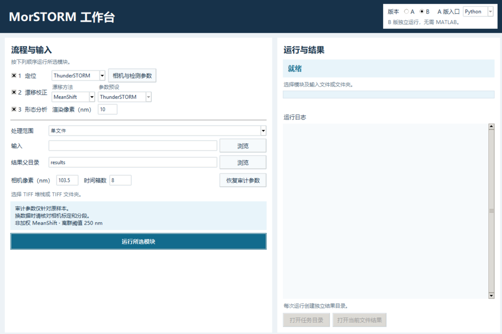

# MorSTORM 双版本工作台

[English](README.md) · [完整安装说明](docs/INSTALL.md) · [验证范围](docs/VALIDATION.md) · [发布核对](docs/RELEASE.md)

MorSTORM 支持定位、漂移校正和形态分析三个模块。界面顶部切换 A/B，提供中英文入口、模块单跑与串行、单文件和文件夹模式。ThunderSTORM 与 Picasso 都可以从 TIFF 独立定位，形态分析统一调用 Fiji 的 MorphoLibJ。



| 能力 | A 版 | B 版 |
| --- | --- | --- |
| 入口 | MATLAB 或 Python | 独立 Python |
| MeanShift | 从原作者安装固定版本 | 内置已验证的 Python 移植 |
| NP-Cloud / RR-NP Cloud / AIM | 从原作者安装固定版本 | 可导入已有本地 B 包中的对应模块 |
| 形态分析 | 单独安装 Fiji/MorphoLibJ | 同一 Fiji/MorphoLibJ |

在仓库根目录用 PowerShell 运行以下命令，可以在无 MATLAB、无 Fiji 的情况下验证 B 版 MeanShift 和合成数据输出。

```powershell
py -3.10 -m venv .venv
.\.venv\Scripts\python.exe -m pip install -c constraints-py310.txt ./MorSTORM-B ./MorSTORM-dual
.\.venv\Scripts\morstorm-b.exe MorSTORM-B/examples/drift-only.json
```

GUI 使用 `Start-Chinese.cmd` 或 `Start-English.cmd`。先按[安装说明](docs/INSTALL.md)设置所需依赖。配置保存在本地忽略文件 `settings.local.json`。处理新的采集文件时，请核实标定和分段。公开候选包的示例为合成数据，B 版本地提供器的导入办法见 [LOCAL_PROVIDERS.md](docs/LOCAL_PROVIDERS.md)。

各模块旁的 **高级参数…** 打开当前算法的面板，可以看到单位、当前值、实测预设值和固定设置。实测预设未填写的项目会显示后端默认值或「未指定」。用 **另存预设…** 保存所选模块和参数，或用 **导入预设…** 载入自己保存的 JSON、仓库里的模板及兼容的 `run-config.json`。A/B 切换时共用这些设置。输入数据和软件路径在运行的电脑上另行选择。**恢复审计参数** 一键清除自定义编辑，并恢复当前流程的实测配置。
